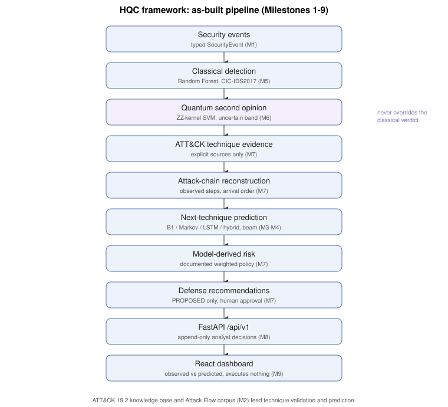

# Final architecture (as built, Milestones 1–9)

This document describes the system **as implemented**. The pre-implementation design is kept unchanged as a snapshot in `analysis/FINAL_ARCHITECTURE.md`. Deliberate differences from it are listed at the end of `ARCHITECTURE.md`, and per-module status is in `ARCHITECTURE.md`.



## Pipeline
```
Security events (typed SecurityEvent: network flow / authentication / system / API)        M1
   │
   ├─ Classical detection: Random Forest (primary, pre-registered), Logistic Regression     M5
   │     CIC-IDS2017 whole-day holdout; fixed 0.5 threshold; train-only preprocessing
   ├─ Quantum second opinion: ZZ fidelity-kernel SVM on the training-derived uncertainty    M6
   │     band (exact simulation); NEVER overrides the classical verdict
   ▼
DetectionEvidence (classical verdict + QuantumOpinion + evidence status)                   M7
TechniqueEvidence (explicit sources only: rule / synthetic annotation / Attack Flow;
   CIC labels are never mapped to ATT&CK techniques; validated against ATT&CK 19.2)        M7
   ▼
IncidentChain: deterministic correlation, arrival order, OBSERVED steps only               M7
   ▼
NextTechniquePrediction: B1 / M1 Markov / LSTM / hybrid (α = 0.7), beam search             M3–M4 (+M7 service)
   │   next-step probabilities ≠ path scores; nothing predicted is labelled observed
   ▼
RiskAssessment: MODEL-DERIVED RISK SCORE, documented weights, quantum weight 0             M7
   ▼
DefenseRecommendation: PROPOSED only, requires_human_approval = true                       M7
   ▼
FastAPI /api/v1: GET reads (recommendations GET-only), POST computations / assessments /   M8
   append-only analyst decisions (two-step approval for HIGH disruption), executed: false
   ▼
React dashboard: observed vs predicted visualisation, decisions recorded never executed    M9
```

## Knowledge layer (M2)
**ATT&CK knowledge base:**
- ATT&CK Enterprise **19.2** STIX 2.1 is parsed into a typed knowledge base.
- Version: 697 active techniques, 15 tactics.
- Contents: mitigations, detection strategies and data components.

**Committed technique vocabulary** (`v1-attack-19.2-f42457f4db96`):
- Validates technique IDs: non-active IDs become `<UNK>` for prediction.
- Defines the prediction output space.

**Attack Flow corpus:**
- Ordered technique sequences from the Attack Flow STIX corpus, version `main@8b6ca28bc13b`: 41 files, 37 source groups.

## Packages (`backend/hqc/`)
| Package | Role |
|---|---|
| `common/` | Typed contracts (`schemas/`), errors, logging, provenance, seeding |
| `config/` | Validated settings (ATT&CK version, paths, CORS without wildcard) |
| `mitre/` | ATT&CK knowledge base, Attack Flow parser and corpus |
| `prediction/` | Vocabulary, baselines, Markov, LSTM, fusion, beam search, `PredictionService` |
| `evaluation/` | Folds, metrics, bootstrap, tuning, experiment tracking |
| `detection/` | CIC-IDS2017 adapter, feature policy, detectors, evaluation |
| `quantum/`, `fusion/` | Feature maps, kernels, CV, bands, adjudicator, noise study; stacking and the disagreement guard |
| `attack_chain/` | Catalog, evidence, correlation and reconstruction |
| `risk/` | `RiskService` |
| `defense/` | `DefenseRecommendationService`; no execution paths (AST guardrail) |
| `pipeline/` | `IntelligencePipeline`, synthetic scenarios, integration checks, tracking |
| `storage/` | SQLite stores. M1: evaluation records are write-once. M8: API-owned tables are append-only (triggers) |
| `api/` | M1 health app (unchanged); M8 `server.py` + `v1/` |

The dashboard lives in `frontend/` (M9): React 19, Vite 8, TypeScript strict, with types generated from the API's OpenAPI document.

## Safety architecture
**Recommendation-only:**
- The defense, risk and API packages are AST-scanned. The scan blocks process, shell, network-client, SSH, firewall, account and cloud modules, dynamic code, file I/O in defense, and command-like literals.
- The API exposes only GET and POST.
- Recommendations are read-only and decisions are append-only. Every decision and view reports `executed: false`.
- The dashboard's static scan forbids raw HTML injection, dynamic code, networking outside the central client, and execution controls.

**Evidence discipline:**
- The quantum second opinion never changes the classical verdict and never raises risk. Disagreement only marks NEEDS ADDITIONAL EVIDENCE and withholds disruptive proposals.
- Predicted steps are never labelled observed.
- CIC-IDS2017 labels are never mapped to ATT&CK techniques.

**Exposure:**
- No static-file mounts, no wildcard CORS, debug off, errors without paths or stack traces.
- **There is no authentication.** Run on localhost or a trusted network only (see `LIMITATIONS.md`).
